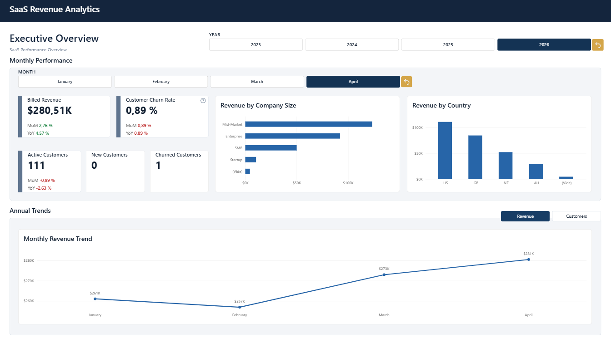

# SaaS Revenue Analytics

## Project Overview

SaaS Revenue Analytics is an end-to-end Analytics Engineering project built around CRM and billing data from HubSpot and Subskribe.

The project transforms raw operational data into reliable, analytics-ready datasets to support customer, subscription, and revenue analysis through Power BI dashboards.

It combines Google Cloud, dbt, Airflow, and Docker for data processing and orchestration, with Terraform for infrastructure management and GitHub Actions for automated testing and deployment.


## Project Roadmap

### Data Engineering
- [x] Data ingestion and BigQuery setup
- [x] dbt staging, intermediate and marts
- [x] Data quality testing
- [x] DEV / CI / PROD environment separation

### Orchestration & Deployment
- [x] Docker containerization
- [x] Airflow DEV orchestration
- [x] Airflow PROD orchestration
- [x] CI pipeline (dbt and Airflow)
- [x] CD pipeline (Airflow PROD deployment)

### Infrastructure as Code
- [x] Terraform infrastructure management (GCP)
- [x] CI pipeline (Terraform validation and plan)
- [x] CD pipeline (Terraform deployment)

### Business Intelligence
- [x] Power BI - Executive Overview
- [ ] Power BI - Revenue & Customer Retention
- [ ] Power BI - Customer Analysis


## Architecture

The following diagram illustrates the current architecture of the SaaS Revenue Analytics platform, including separate development, CI, and production environments.

```text
                         HubSpot / Subskribe
                                  │
                                  ▼
                         Google Cloud Storage
                                  │
                  ┌───────────────┴───────────────┐
                  │                               │
                  ▼                               ▼
           DEV ingestion                    PROD ingestion
             (Airflow)                        (Airflow)
                  │                               │
                  ▼                               ▼
          BigQuery raw_dev                   BigQuery raw
                  │                               │
           ┌──────┴──────┐                        │
           │             │                        │
           ▼             ▼                        ▼
       DEVELOPMENT       CI                   PRODUCTION
        dbt_karim      dbt_ci                     │
           │             │               ┌────────┴─────────┐
           ▼             ▼               ▼                  ▼
      stg/int/marts  stg/int/marts  dbt_prod_technical   analytics
                                        stg / int          marts
                                                             │
                                                             ▼
                                                          Power BI
```
The DEV and CI environments share the same BigQuery RAW dataset ('raw_dev') but execute dbt transformations independently. Airflow DEV orchestrates data ingestion and dbt transformations into 'dbt_karim', while GitHub Actions CI runs 'dbt build' in the isolated 'dbt_ci' dataset.

In production, Airflow orchestrates data ingestion into the BigQuery 'raw' dataset, followed by dbt transformations in 'dbt_prod_technical' (staging and intermediate models) and 'analytics' (marts), which are consumed by Power BI.

```text
                            CI/CD - GitHub Actions


          PULL REQUEST TO MAIN                         MERGE TO MAIN
                  │                                          │
                  ▼                                          ▼
          GitHub Actions CI                          GitHub Actions CD
                  │                                          │
         ┌────────┼────────┐                       ┌─────────┴─────────┐
         │        │        │                       │                   │
         ▼        ▼        ▼                       ▼                   ▼
       dbt CI  Airflow CI  Terraform CI         Airflow CD         Terraform CD
         │        │        │                       │                   │
         ▼        ▼        ▼                       ▼                   ▼
     dbt build   Docker   fmt / validate      Self-hosted         GitHub-hosted
     (dbt_ci)    build    terraform plan      runner Windows      runner Ubuntu
                DAG checks                         │                   │
                                                   ▼                   ▼
                                              Docker Compose      Terraform plan
                                              Build & deploy           │
                                                   │                   ▼
                                                   ▼              Manual approval
                                             ┌───────────────┐         │
                                             │ AIRFLOW PROD  │         ▼
                                             │               │    Terraform apply
                                             │ GCS → BigQuery│         │
                                             │      │ (raw)  │         ▼
                                             │      ▼        │    GCP Infrastructure
                                             │  dbt build    │    GCS / BigQuery
                                             └───────────────┘    IAM / WIF
```
GitHub Actions automates CI/CD workflows for dbt, Airflow, and Terraform.

Pull requests to 'main' trigger validation workflows on GitHub-hosted Ubuntu runners: dbt builds and tests models in 'dbt_ci', Airflow validates Docker builds and DAGs, and Terraform runs formatting checks, validation, and infrastructure planning.

After merging into 'main', Airflow CD deploys the production environment through Docker Compose using a self-hosted Windows runner. Terraform CD, when triggered by infrastructure changes, uses a GitHub-hosted Ubuntu runner to plan and apply changes to GCP infrastructure, with manual approval required before deployment.

Airflow PROD then orchestrates data ingestion from Google Cloud Storage into BigQuery and executes dbt transformations when its production DAGs are triggered.


## Data Source & Credits

This project is based on the public Tracksuit Data Engineer Analytics take-home task.

The original business case and sample HubSpot and Subskribe datasets were provided by Tracksuit.

Original source: [Tracksuit Data Engineer Analytics Take-Home Task](https://github.com/gotracksuit/tracksuit-data-engineer-analytics-take-home-task-public)

The project was independently extended into a complete Analytics Engineering workflow, including data architecture, dbt modeling, data quality testing, environment separation, automated CI/CD, infrastructure management with Terraform, and containerized workflow orchestration with Docker and Airflow.


## Data Ingestion & Orchestration

The data pipelines are orchestrated using Apache Airflow 3.1.8, with separate DEV and PROD environments running locally in Docker containers managed by Docker Compose.

### Airflow DAGs

Both environments use the same orchestration logic, implemented through a shared ingestion DAG and environment-specific pipeline DAGs:

- **gcs_to_bigquery_raw:** ingests four source CSV files from Google Cloud Storage into the corresponding BigQuery RAW dataset, replacing existing table contents on each run. The destination dataset is configured through the BQ_RAW_DATASET environment variable.
- **saas_revenue_pipeline_dev / saas_revenue_pipeline_prod:** orchestrate the complete pipeline by triggering RAW ingestion, followed by the corresponding dbt build upon successful ingestion, executing data transformations and quality tests.

### Environment Configuration

The DEV and PROD environments execute the same pipeline with separate BigQuery datasets and dbt targets.

| Environment | RAW dataset | dbt target | Transformation datasets           |
|-------------|-------------|------------|-----------------------------------|
| DEV         | 'raw_dev'   | DEV        | 'dbt_karim'                       |
| PROD        | 'raw'       | PROD       | 'dbt_prod_technical', 'analytics' |

### Security & Credentials

GCP access is managed through dedicated service accounts following the principle of least privilege. Separate identities are used for data ingestion, dbt transformations, and infrastructure management, with permissions scoped to their respective responsibilities.

For Airflow PROD, GCP credentials and environment configuration files are stored outside the GitHub repository in a dedicated local directory, protected by Windows NTFS permissions. Docker Compose mounts these files into the production containers at runtime.

Terraform CI/CD workflows use Workload Identity Federation (WIF) to authenticate with GCP without storing long-lived service account keys in GitHub. Separate service accounts are used for CI validation and planning versus CD deployment, with manual approval required before applying infrastructure changes.

Terraform state is stored remotely in a dedicated Google Cloud Storage bucket with versioning enabled. Terraform CI can read the state but cannot modify it. Its only write permissions are restricted to creating and deleting the '.tflock' file, which Terraform uses to lock the state during planning and prevent concurrent operations from interfering with each other.


## Data Modeling

### Source Data Exploration

Before building the dbt models, the raw HubSpot and Subskribe datasets were extensively explored in BigQuery to understand their structure, relationships, and business rules.

The analysis focused on four main areas:

- **Key validation:** uniqueness and completeness of company, account, subscription, and invoice identifiers.
- **Relationship integrity:** validation of the relationships between accounts, subscriptions, and invoices, as well as the reconciliation of customer identifiers between HubSpot and Subskribe.
- **Subscription lifecycle:** analysis of subscription states, date consistency, renewal chains, and renewal continuity to understand how customer lifecycles are represented in the source data.
- **Invoice and revenue behavior:** analysis of invoice statuses, amounts, billing frequency, and invoice distribution to establish reliable revenue rules.

These checks were used not only to identify data quality issues, but also to derive business rules and guide the design of the analytical models.


### Modeling Approach

The dbt project follows a three-layer modeling approach to separate source preparation, business logic, and analytics-ready datasets.

- **Staging:** standardizes the raw HubSpot and Subskribe data through column renaming, type casting, and basic cleaning while remaining close to the source.
- **Intermediate:** handles reusable business logic and more complex transformations, including customer identifier reconciliation and subscription lifecycle reconstruction.
- **Marts:** provides business-ready dimensional models for analytics and reporting, organized around customers, subscriptions, invoices, and dates.

This separation keeps source-specific transformations isolated from business logic and makes the models easier to understand, test, and maintain.


### Customer Identity Resolution

One of the main modeling challenges was reconciling customer identities between HubSpot and Subskribe.

Subskribe accounts reference HubSpot companies through a CRM identifier, but some of these identifiers no longer matched the current HubSpot company_id. Investigation of the HubSpot data showed that most unmatched identifiers corresponded to historical company IDs stored in merged_object_ids, resulting from company records that had previously been merged.

A dedicated intermediate model, int_hubspot__company_id_mapping, was created to resolve both current and historical HubSpot identifiers to the appropriate company.

This reconciliation logic was intentionally kept separate from dim_customers to centralize identity resolution, avoid duplicating mapping logic, and keep the final customer dimension focused on analytics-ready attributes.

Identifiers that could not be reliably reconciled were left unresolved rather than forcing an uncertain customer relationship.


### Analytics Marts

The final analytics layer consists of four business-ready models:

- **dim_customers:** unified customer information from HubSpot and Subskribe.
- **dim_date:** shared calendar dimension for time-based analysis.
- **fct_subscriptions:** subscription lifecycle and renewal history.
- **fct_invoices:** invoice and billed revenue analysis.

These models form the analytics layer designed to support reporting and visualization in Power BI.


## Data Quality & Testing

Data quality checks are integrated directly into the dbt workflow and executed automatically during dbt builds.

The testing strategy combines generic dbt tests with custom singular tests covering:

- primary key uniqueness and non-null constraints;
- accepted values for controlled fields such as subscription and invoice statuses;
- referential integrity between related models;
- custom business rules and relationships that cannot be validated through generic tests alone.

These tests help detect data quality issues and business logic inconsistencies before changes are deployed to production.


## CI/CD & Environments

The project uses separate DEV, CI, and PROD environments to isolate development, automated validation, and production workloads.

### dbt Environments

- **DEV - dbt_karim:** development environment used to build, test, and refine dbt models.
- **CI - dbt_ci:** isolated environment used to validate dbt models automatically during pull requests.
- **PROD - dbt_prod_technical / analytics:** production environment separating staging and intermediate transformations from business-ready analytics marts.

### GitHub Actions Workflows

GitHub Actions automates continuous integration and production deployment through separate CI and CD workflows.

- **dbt CI:** runs 'dbt build' against the CI target for pull requests to 'main', validating transformations and data quality tests in 'dbt_ci'.
- **Airflow CI:** builds the Airflow DEV Docker image and validates DAG Python syntax, imports, and DAG availability during pull requests to 'main'.
- **Terraform CI:** runs 'terraform fmt', 'terraform validate', and 'terraform plan' during pull requests to 'main', without applying infrastructure changes.
- **Airflow CD:** triggered by changes merged into 'main', using a self-hosted Windows runner and Docker Compose to build the production Docker image and deploy the Airflow PROD containers.
- **Terraform CD:** triggered by Terraform-related changes merged into 'main', generating an infrastructure plan and applying changes to GCP after manual approval.

CI workflows run on GitHub-hosted Ubuntu runners. Airflow CD uses a self-hosted Windows runner, while Terraform CD runs on a GitHub-hosted Ubuntu runner.

Terraform CI/CD workflows use a shared remote state backend in Google Cloud Storage to maintain consistency between infrastructure planning and deployment.


## Power BI Dashboard

### Executive Overview

The Executive Overview dashboard provides a consolidated view of SaaS business performance through key revenue, customer, and churn metrics.

Built with Power BI, it features custom KPI cards powered by DAX measures, dynamic year and month slicers, MoM and YoY comparisons, conditional formatting, interactive cross-filtering, informational tooltips, and bookmark-driven visual navigation.

**Data Coverage:** The dataset covers SaaS activity through April 2026, the last complete month available for analysis. Reporting is limited to this period to ensure consistent monthly KPIs and avoid comparisons based on incomplete months.


