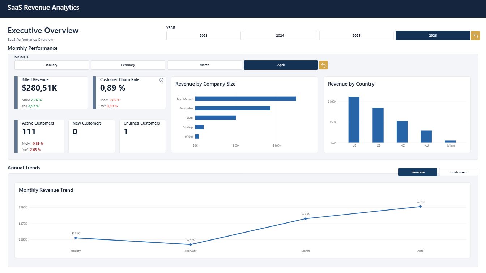

# SaaS Revenue Analytics

## Project Overview

SaaS Revenue Analytics is an end-to-end Analytics Engineering project built around CRM and billing data from HubSpot and Subskribe.

The project transforms raw operational data into reliable, analytics-ready datasets for analyzing customers, subscriptions, invoices, and SaaS revenue.

The project is designed as a modern analytics workflow covering data ingestion, transformation and
modeling with BigQuery and dbt, data quality testing, environment separation,
automated CI/CD pipelines, business intelligence with Power BI, and workflow
orchestration with Airflow.

Docker is used to containerize separate Airflow DEV and PROD environments, ensuring consistent and isolated workflow orchestration. GitHub Actions automates CI validation and production deployment through a self-hosted Windows runner and Docker Compose. Future infrastructure improvements include deployment on a Google Cloud VM and Infrastructure as Code with Terraform.


## Project Roadmap

### Data Engineering
- [x] Data ingestion and BigQuery setup
- [x] dbt staging, intermediate and marts
- [x] Data quality testing
- [x] DEV / CI / PROD environment separation

### Orchestration & Deployment
- [x] Docker containerization
- [x] Airflow DEV orchestration
- [x] Airflow PROD orchestration
- [x] CI pipeline (dbt and Airflow)
- [x] CD pipeline (Airflow PROD deployment)

### Infrastructure as Code
- [ ] Terraform infrastructure

### Business Intelligence
- [x] Power BI - Executive Overview
- [ ] Power BI - Revenue & Customer Retention
- [ ] Power BI - Customer Analysis


## Architecture

The following diagram illustrates the current architecture of the SaaS Revenue Analytics platform, including separate development, CI, and production environments.

```text
                         HubSpot / Subskribe
                                  │
                                  ▼
                         Google Cloud Storage
                                  │
                  ┌───────────────┴───────────────┐
                  │                               │
                  ▼                               ▼
           DEV ingestion                    PROD ingestion
             (Airflow)                        (Airflow)
                  │                               │
                  ▼                               ▼
          BigQuery raw_dev                   BigQuery raw
                  │                               │
           ┌──────┴──────┐                        │
           │             │                        │
           ▼             ▼                        ▼
       DEVELOPMENT       CI                   PRODUCTION
        dbt_karim      dbt_ci                     │
           │             │              ┌─────────┴─────────┐
           ▼             ▼              ▼                   ▼
      stg/int/marts  stg/int/marts  dbt_prod_technical   analytics
                                       stg / int           marts
                                                             │
                                                             ▼
                                                          Power BI
```
The DEV and CI environments share the same BigQuery RAW dataset ('raw_dev') but execute dbt transformations independently. Airflow DEV orchestrates ingestion and dbt transformations into 'dbt_karim', while GitHub Actions CI runs 'dbt build' in the isolated 'dbt_ci' dataset when a pull request is opened or updated.

```text
                         CI/CD - GitHub Actions

          Pull Request to main              Merge to main
                   │                              │
                   ▼                              ▼
            GitHub Actions                 GitHub Actions
                  CI                             CD
                   │                              │
                   ▼                              ▼
          GitHub-hosted runner             Self-hosted runner
               (Ubuntu)                       (Windows)
                   │                              │
          ┌────────┴────────┐                     ▼
          │                 │               Docker Compose
          ▼                 ▼               Build & deploy
       dbt CI           Airflow CI           Airflow PROD
          │                 │                     │
          ▼                 ▼                     ▼
      dbt build       Docker build      ┌────────────────────┐
      (dbt_ci)        DAG validation    │    AIRFLOW PROD    │
                                        │                    │
                                        │  Docker containers │
                                        │                    │
                                        │  DAG orchestration │
                                        │  GCS → BigQuery    │
                                        │        ↓           │
                                        │     dbt build      │
                                        └────────────────────┘
```
GitHub Actions automates continuous integration and deployment using separate runners. Pull requests trigger dbt and Airflow validation on GitHub-hosted Ubuntu runners. After merging into 'main', a self-hosted Windows runner uses Docker Compose to build and deploy the Airflow PROD environment. Airflow PROD then orchestrates data ingestion from Google Cloud Storage into BigQuery 'raw', followed by dbt transformations in 'dbt_prod_technical' and 'analytics'.


## Data Source & Credits

This project is based on the public Tracksuit Data Engineer Analytics take-home task.

The original business case and sample HubSpot and Subskribe datasets were provided by Tracksuit.

Original source: [Tracksuit Data Engineer Analytics Take-Home Task](https://github.com/gotracksuit/tracksuit-data-engineer-analytics-take-home-task-public)

The project was independently extended into a complete Analytics Engineering workflow, including data architecture, dbt modeling, data quality testing, environment separation, automated CI/CD, and containerized workflow orchestration with Docker and Airflow.


## Data Ingestion & Orchestration

The data pipelines are orchestrated using Apache Airflow 3.1.8, with separate DEV and PROD environments running locally in Docker containers managed by Docker Compose.

### Airflow DAGs

Both environments use the same orchestration logic through two DAGs:

- **gcs_to_bigquery_raw:** ingests the four source CSV files from Google Cloud Storage into BigQuery, replacing existing table contents on each run. The destination dataset is configured through the BQ_RAW_DATASET environment variable.
- **saas_revenue_pipeline_dev / saas_revenue_pipeline_prod:** orchestrate the complete pipeline by triggering RAW ingestion, followed by the corresponding dbt build upon successful ingestion, including transformations and data quality tests.

### Environment Configuration

The DEV and PROD environments execute the same pipeline with separate BigQuery datasets and dbt targets.

| Environment | RAW dataset | dbt target | Transformation datasets           |
|-------------|-------------|------------|-----------------------------------|
| DEV         | 'raw_dev'   | DEV        | 'dbt_karim'                       |
| PROD        | 'raw'       | PROD       | 'dbt_prod_technical', 'analytics' |

### Security & Credentials

DEV and PROD use dedicated GCP service accounts with permissions restricted according to their responsibilities. Separate accounts are used for data ingestion and production dbt transformations, limiting access to the required Google Cloud Storage and BigQuery resources.

In production, GCP credentials and environment configuration files are stored outside the GitHub repository in a dedicated local directory. Windows NTFS permissions restrict access to authorized Windows accounts, including the account running the self-hosted GitHub Actions runner.

During deployment, Docker Compose mounts the required credentials into the Airflow PROD containers, allowing the production pipeline to authenticate with GCP without storing sensitive files in the repository.


## Data Modeling

### Source Data Exploration

Before building the dbt models, the raw HubSpot and Subskribe datasets were extensively explored in BigQuery to understand their structure, relationships, and business rules.

The analysis focused on four main areas:

- **Key validation:** uniqueness and completeness of company, account, subscription, and invoice identifiers.
- **Relationship integrity:** validation of the relationships between accounts, subscriptions, and invoices, as well as the reconciliation of customer identifiers between HubSpot and Subskribe.
- **Subscription lifecycle:** analysis of subscription states, date consistency, renewal chains, and renewal continuity to understand how customer lifecycles are represented in the source data.
- **Invoice and revenue behavior:** analysis of invoice statuses, amounts, billing frequency, and invoice distribution to establish reliable revenue rules.

These checks were used not only to identify data quality issues, but also to derive business rules and guide the design of the analytical models.


### Modeling Approach

The dbt project follows a three-layer modeling approach to separate source preparation, business logic, and analytics-ready datasets.

- **Staging:** standardizes the raw HubSpot and Subskribe data through column renaming, type casting, and basic cleaning while remaining close to the source.
- **Intermediate:** handles reusable business logic and more complex transformations, including customer identifier reconciliation and subscription lifecycle reconstruction.
- **Marts:** provides business-ready dimensional models for analytics and reporting, organized around customers, subscriptions, invoices, and dates.

This separation keeps source-specific transformations isolated from business logic and makes the models easier to understand, test, and maintain.


### Customer Identity Resolution

One of the main modeling challenges was reconciling customer identities between HubSpot and Subskribe.

Subskribe accounts reference HubSpot companies through a CRM identifier, but some of these identifiers no longer matched the current HubSpot company_id. Investigation of the HubSpot data showed that most unmatched identifiers corresponded to historical company IDs stored in merged_object_ids, resulting from company records that had previously been merged.

A dedicated intermediate model, int_hubspot__company_id_mapping, was created to resolve both current and historical HubSpot identifiers to the appropriate company.

This reconciliation logic was intentionally kept separate from dim_customers to centralize identity resolution, avoid duplicating mapping logic, and keep the final customer dimension focused on analytics-ready attributes.

Identifiers that could not be reliably reconciled were left unresolved rather than forcing an uncertain customer relationship.


### Analytics Marts

The final analytics layer consists of four business-ready models:

- **dim_customers:** unified customer information from HubSpot and Subskribe.
- **dim_date:** shared calendar dimension for time-based analysis.
- **fct_subscriptions:** subscription lifecycle and renewal history.
- **fct_invoices:** invoice and billed revenue analysis.

These models form the analytics layer designed to support reporting and visualization in Power BI.


## Data Quality & Testing

Data quality checks are integrated directly into the dbt workflow and executed automatically during dbt builds.

The testing strategy combines generic dbt tests with custom singular tests covering:

- primary key uniqueness and non-null constraints;
- accepted values for controlled fields such as subscription and invoice statuses;
- referential integrity between related models;
- custom business rules and relationships that cannot be validated through generic tests alone.

These tests help detect data quality issues and business logic inconsistencies before changes are deployed to production.


## CI/CD & Environments

The project uses separate DEV, CI, and PROD environments to isolate development, automated validation, and production workloads.

### dbt Environments

- **DEV - dbt_karim:** development environment used to build, test, and refine dbt models.
- **CI - dbt_ci:** isolated environment used to validate dbt models automatically during pull requests.
- **PROD - dbt_prod_technical / analytics:** production environment separating staging and intermediate transformations from business-ready analytics marts.

### GitHub Actions Workflows

GitHub Actions automates continuous integration and production deployment through separate CI and CD workflows.

- **dbt CI:** runs 'dbt build' against the CI target for pull requests to 'main', validating transformations and data quality tests in 'dbt_ci'.
- **Airflow CI:** builds the Airflow DEV Docker image and validates DAG Python syntax, imports, and DAG availability during pull requests to 'main'.
- **Airflow CD:** triggered by changes merged into 'main', using a self-hosted Windows runner and Docker Compose to build the production Docker image and deploy the Airflow PROD containers.

CI workflows execute on GitHub-hosted Ubuntu runners, while production deployment runs on the self-hosted Windows runner.


## Power BI Dashboard

### Executive Overview

The Executive Overview dashboard provides a consolidated view of SaaS business performance through key revenue, customer, and churn metrics.

Built with Power BI, it features custom KPI cards powered by DAX measures, dynamic year and month slicers, MoM and YoY comparisons, conditional formatting, interactive cross-filtering, informational tooltips, and bookmark-driven visual navigation.

**Data Coverage:** The dataset covers SaaS activity through April 2026, the last complete month available for analysis. Reporting is limited to this period to ensure consistent monthly KPIs and avoid comparisons based on incomplete months.


